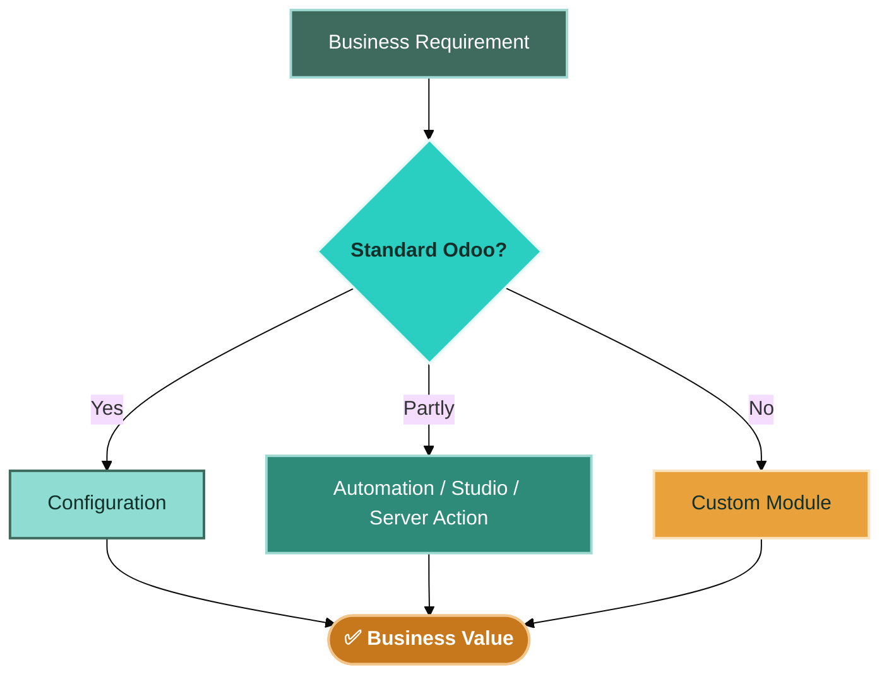
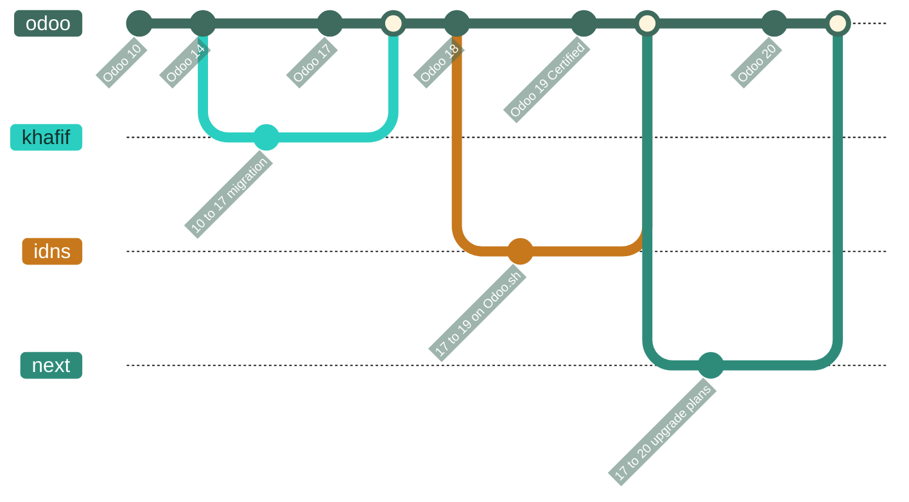
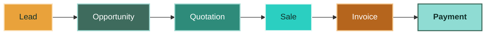
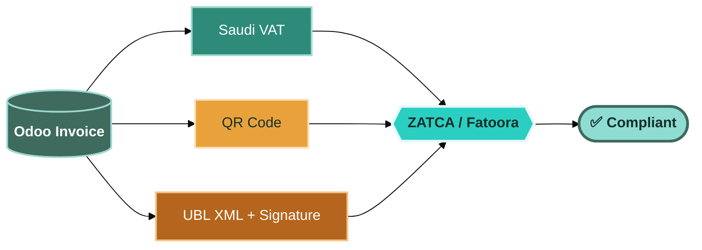

<!-- ========================================================= -->
<!--                 NOOH SULIMAN — GITHUB README                -->
<!-- ========================================================= -->

  

  

  
  
  

  
  
  
  
  
  

---

## 👋 Who I Am

I turn business requirements into **practical, scalable Odoo solutions** — and I can take them all the way from the first workshop to the last line of Python.

- 🏢 **Now:** Senior Odoo Techno-Functional Consultant at **DWP IT Arabia**
- 🧠 **5+ years** in Odoo · **10+ ERP implementations** · **100+ training sessions**
- 🇸🇦 Deep in Saudi localization: **ZATCA / Fatoora**, Saudi VAT, bilingual Arabic/English documents
- 🔧 Functional lead who also **builds the modules**: integrations, approval workflows, inventory logic, QWeb reports
- 📈 Currently working on **Odoo 20** and helping clients upgrade from 17

> [!TIP]
> **My rule:** Configure before customizing. Every line of custom code has to earn its place in business value.

---

## 📊 At a Glance

<table align="center">
  <tr>
    <td align="center" width="160"><h2>5+</h2>Years in Odoo</td>
    <td align="center" width="160"><h2>10+</h2>ERP Implementations</td>
    <td align="center" width="160"><h2>60+</h2>Branches Supported</td>
    <td align="center" width="160"><h2>100+</h2>Training Sessions</td>
    <td align="center" width="160"><h2>10→20</h2>Odoo Versions</td>
  </tr>
</table>

---

## 🧭 How I Deliver

```mermaid
%%{init: {'theme':'base','themeVariables':{'fontFamily':'Segoe UI, sans-serif','lineColor':'#2BCFC1'}}}%%
flowchart LR
    A([🏢 Business]) --> B[🔎 Requirements]
    B --> C[🗺️ AS-IS → TO-BE]
    C --> D{🔍 Fit-Gap}
    D -->|Standard| E[⚙️ Configure]
    D -->|Gap| F[🧩 Customize / Integrate]
    E --> G[🧪 UAT]
    F --> G
    G --> H[👨‍🏫 Training]
    H --> I([🚀 Go-Live])
    I --> J[📈 Hypercare & Optimize]

    classDef gold fill:#C7781C,stroke:#F3C58A,stroke-width:2px,color:#FFFFFF,font-weight:bold
    classDef violet fill:#3E6B5D,stroke:#9FD9D1,stroke-width:2px,color:#FFFFFF
    classDef blue fill:#2E8B7A,stroke:#9FD9D1,stroke-width:2px,color:#FFFFFF
    classDef teal fill:#2BCFC1,stroke:#E6FAF7,stroke-width:2px,color:#12302A,font-weight:bold
    classDef green fill:#8FDCD3,stroke:#3E6B5D,stroke-width:2px,color:#12302A
    classDef pink fill:#E9A23B,stroke:#FCE3BE,stroke-width:2px,color:#12302A
    classDef orange fill:#B5651D,stroke:#F3C58A,stroke-width:2px,color:#FFFFFF
    class A,I gold
    class B violet
    class C,H blue
    class D teal
    class E,J green
    class F pink
    class G orange
```

🔎 <b>Requirements & Pre-Sales</b> — workshops, scope, proposals

 

- Discovery workshops with finance, operations and management
- Business, functional and technical requirement documents
- **Scope of Work & commercial proposals** for clients in real estate, hospitality, trading, agriculture and non-profit sectors
- Estimation and phased delivery plans (including upgrade plans for full custom-module portfolios)

🔍 <b>Fit-Gap & Solution Design</b> — standard first, always

 

Security groups · approval workflows · accounting flows · reports · dashboards · integrations

🧪 <b>UAT, Training & Go-Live</b> — adoption is the real deliverable

 

- Test scenarios, UAT sessions and sign-off
- **Bilingual Arabic / English user guides** per module
- Master data preparation and migration validation
- Go-live support, hypercare and continuous optimization

---

## 🛠️ Featured Engineering Work

> Custom modules and integrations I designed and built — not just specified.

<!-- Tip: once a module is public, wrap its name in a link to its repo -->

| Module | Odoo | What it does | Tech |
|:--|:--:|:--|:--|
| 🛵 **Taker Connector** | 17 | Full integration between the Taker food-delivery platform and Odoo Sales: webhook receiver, token auth, cron fallback polling, partner & order-line mapping | `Controllers` `REST` `Cron` |
| ♻️ **Scrap Approval** | 18 | Approval workflow on scrap orders: waiting / rejected / cancelled states, cancellation wizard, manager group, chatter audit trail | `ORM` `Wizards` `Security` |
| 🏷️ **SO Lot / Serial Selection** | 19 | Pick lots on sale order lines, frozen lots, expiry status, lots carried to delivery and invoice lines | `Stock` `Sale` `Account` |
| 🧾 **ZATCA Invoice Customization** | 17 | QWeb/XPath extensions of the Saudi e-invoice: advance & retention amounts, customer codes, bilingual RTL/LTR layout | `QWeb` `l10n_sa_edi` |
| 🕐 **Monthly Permission Leave** | 18 | Accrual plans and server actions for monthly permission hours with no carry-over; fixed a cron overwriting allocation dates | `HR` `Server Actions` `Cron` |
| 🧑‍💼 **POS Default Customer** | 19 | Automatically assigns a configured default customer to new POS orders | `POS` `OWL` |
| 🌐 **Company Website on Odoo** | 18 | Corporate site with online appointment booking, deployed behind Nginx with SSL | `Website` `Nginx` `Certbot` |

☁️ <b>Upgrades & Migrations</b>

 

- **Khafif Food — Odoo 10 → 17:** full migration, retraining, ZATCA Phase I & II
- **IDNS — Odoo 17 → 19 on Odoo.sh:** resolved dependency failures across four custom modules, ZATCA re-validation, staging → production
- **Odoo 17 → 20:** upgrade planning and delivery for client systems with full custom-module portfolios

---

## 🚀 ERP Implementations

🏭 <b>Nesco Company</b> · Odoo 18 · 50+ users · 61+ branches

 

Multi-branch ERP across 61+ branches: Sales, Purchase, Inventory, Accounting and HR — with **ZATCA**, **biometric attendance integration**, multi-level purchase approvals, scrap approval, POS analytic accounts and bilingual user guides for every custom flow.

🏥 <b>Al-Hadithi Medical</b> · Odoo 19 · 80+ users

 

ERP for a medical supplies company: Inventory, Sales, Purchasing and Accounting, with customized purchasing and business workflows.

🏗️ <b>Abhaj Contracting</b> · Odoo 18 · 30 users

 

Project tracking, procurement and financial control for a contracting business.

🏭 <b>NPS</b> · Odoo 17 · Coffee manufacturing

 

Production, inventory, sales and manufacturing cost processes.

🦺 <b>Unitedest Pest Control</b> · Odoo 17 · 20 users

 

Sales, CRM, Accounting, Subscriptions, Invoicing and Projects for a pest control service business.

☁️ <b>IDNS</b> · Odoo 17 → 19 · Odoo.sh

 

Version upgrade, custom-module compatibility, ZATCA validation, report fixes, user training and deployment.

🏢 <b>EPA Internal ERP</b> · Odoo 18 · Self-hosted

 

Internal ERP for EPA, configured and hosted on an external server for centralized operations and remote access.

---

## 🇸🇦 ZATCA / Fatoora

`Phase I` · `Phase II` · `Multi-branch sequences` · `Bilingual invoice layouts` · `Retention & advance amounts` · `Centralized reporting`

---

## 💼 Experience

🟢 <b>DWP IT Arabia</b> — Senior Odoo Techno-Functional Consultant · <i>2026 – Present</i>

 

Leading Odoo implementations and upgrades end to end: requirements, solution design, custom development coordination, UAT and go-live.

⚪ <b>Expedite Processing Administration (EPA)</b> — Odoo Techno-Functional Consultant · <i>Jun 2025 – 2026</i>

 

Certified Odoo Silver Partner, Khobar. Delivered Nesco, Al-Hadithi Medical, Unitedest, NPS, Abhaj and the IDNS upgrade. Built the company website on Odoo.

⚪ <b>Khafif Food Company</b> — Odoo Functional Consultant · <i>Oct 2024 – Dec 2025</i>

 

Owned the Odoo 10 → 17 migration, ZATCA Phase I & II, and day-to-day support across Manufacturing, POS, Inventory, Accounting, Purchase, Sales and CRM.

⚪ <b>Earlier</b> — Freelance · WAJID IT Solutions · Saleh Company · <i>2020 – 2024</i>

 

- **Freelance Odoo Implementation** (Riyadh, 2024)
- **WAJID IT Solutions** — Odoo Functional Consultant: requirements, gap analysis, configuration, training
- **Saleh Company** — Technical Support & Odoo Administrator: internal Odoo users, configuration and support

---

## 🧩 Odoo Apps I Work With

  
  
  
  
  
  
   
  
  
  
  
  
  
  

## ⚙️ Tech Stack

  

| Area | What I actually do with it |
|:--|:--|
| 🐍 **Python / ORM** | Models, computed fields, wizards, server actions, crons |
| 🧾 **XML / QWeb** | Views, XPath inheritance, bilingual PDF reports |
| 🌐 **Controllers / REST** | Webhooks and third-party platform integrations |
| 🐘 **PostgreSQL** | Data checks, migration validation, troubleshooting |
| 🐧 **Linux / Nginx** | Odoo server setup, multi-domain hosting, SSL |
| ☁️ **Odoo.sh** | Staging/production branches, upgrades, restores |

---

## 🌍 Industries

  
  
  
  
   
  
  
  
  

---

## 🏆 Certifications & Memberships

| | |
|:--|:--|
| ⭐ **Odoo 19 Functional Certification** | Odoo · 2026 |
| 🏛️ **Member — Saudi Council of Engineers** | Specialist, Information Systems · since 2024 |
| ⚙️ **Odoo Technical Program** | 2024 |
| 🧭 **Understanding the Enterprise Systems Environment** | SAP · 2024 |
| 🔐 **Network Security** | Cisco · 2024 |
| ☁️ **Google IT Support Professional Certificate** | Google / Coursera · 2024 |
| 🤝 **Customer Service & Customer Experience** | Alfaisal University · 2023–2024 |
| 🎓 **B.Sc. Computer Science & Information Systems** | Omdurman Islamic University · 2014–2020 |

---

## 📈 GitHub Activity

  
  

  

  <picture>
    <source media="(prefers-color-scheme: dark)" srcset="https://raw.githubusercontent.com/NoohSD/NoohSD/output/github-contribution-grid-snake-dark.svg"/>
    
  </picture>

---

## 🤝 Let's Work Together

I help companies in Saudi Arabia and the region with **Odoo implementations, upgrades, ZATCA compliance and custom modules**.

  
  

  

  

